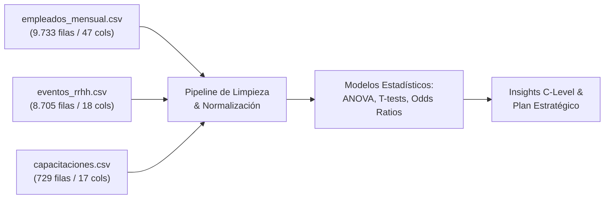

# TechnoStamp Industries: Del Dato a la Decisión Estratégica
## Informe Ejecutivo de Decision Science para el Directorio y CEO

**Preparado por:** People Analytics & Decision Science Advisory  
**Destinatarios:** Martina Rosales (Head of RRHH), CEO y Miembros del Directorio  
**Fecha:** Octubre 2026  
**Alcance del Diagnóstico:** 9.733 registros mensuales (17 meses: Enero 2024 a Mayo 2025), 8.705 eventos de RRHH, 729 registros de capacitación y 694 empleados totales.  
**Entregables complementarios:** Presentación oficial [Presentacion_Directorio_TechnoStamp.pptx](file:///c:/Users/nico_/OneDrive/Desktop/PROYECTOS/nivii_decision_science_assignment/Presentacion_Directorio_TechnoStamp.pptx), Tablero interactivo [dashboard_ejecutivo.html](file:///c:/Users/nico_/OneDrive/Desktop/PROYECTOS/nivii_decision_science_assignment/dashboard_ejecutivo.html) y Pipeline de código reproducible [src/analysis_pipeline.py](file:///c:/Users/nico_/OneDrive/Desktop/PROYECTOS/nivii_decision_science_assignment/src/analysis_pipeline.py).

---

## 1. Resumen Ejecutivo (Executive Summary)

TechnoStamp Industries se encuentra en un momento bisagra. Tras 15 años de decisiones basadas en la intuición de sus líderes, los datos históricos de gestión revelan una desconexión crítica entre la toma de decisiones corporativa y la realidad en planta. 

Nuestro análisis de Decision Science descubrió que los principales dolores operativos (scrap elevado, accidentes laborales, fatiga por horas extra y rotación voluntaria) no son problemas aislados, sino **síntomas interconectados de un modelo de gestión desarticulado**:

1. **La Crisis del Turno Noche:** El Turno Noche opera en virtual abandono gerencial (0 supervisores de nivel 3 o 4 en planta), disparando la **tasa de scrap al 3,60% (+101% vs. diurno)** y concentrando el **55,6% de todos los accidentes** y el **83,3% de los accidentes graves**, con un riesgo relativo 5,3 veces superior.
2. **El Abismo de Sucesión en Logística y Estampado:** De las 5 posiciones críticas activas en la empresa, **4 de ellas (80%) se jubilan en los próximos 12 meses**. En el área de Logística, **el 100% de la línea de mando** (la Supervisora y ambos Team Leaders) cesará sus funciones en menos de un año sin un plan de relevo formalizado.
3. **La Paradoja de las Horas Extra ($1.422 Millones):** La empresa acumuló un gasto de **$1.422 millones de pesos en 98.260 horas extra**, con un 99,8% de los operarios sobrecargados crónicamente. La causa raíz no es la demanda productiva, sino la lentitud en la selección técnica (Time to Fill de **58,5 días en Mantenimiento**, con picos de 144 días en electricistas).
4. **La Brecha en Seguridad Ocupacional:** El **78% de las víctimas de accidentes jamás recibió capacitación formal en seguridad**. Pese a haber destinado $48,2 millones a capacitaciones, el plan priorizó cursos generales de gestión sobre la prevención de riesgos mecánicos (atrapamientos en prensas, sobreesfuerzos y caídas).
5. **Diversidad y la Paradoja del Desempeño Femenino:** Aunque existe un 37% de representación femenina, se detecta una fuerte segregación horizontal en **Ensamble (26,8% F)** e **Ingeniería (28,6% F)**. Las mujeres demuestran un rendimiento superior (rating 3,26 vs. 3,17; 9,1% vs. 7,3% Top Performers), pero enfrentan un techo de cristal en jefaturas técnicas y una brecha salarial del 7,3% en el nivel gerencial.

> [!IMPORTANT]
> **Impacto en P&L:** La implementación de nuestro plan de acción a 30-60-90 días proyecta un **ahorro neto superior a los $350 Millones de pesos anuales** mediante la reducción del scrap nocturno (llevarlo del 3,60% al 2,0%) y la optimización del 25% del gasto en horas extra mediante cobertura oportuna de vacantes.

---

## 2. Auditoría de Datos, Calidad y Metodología Analítica

En cumplimiento de las buenas prácticas de Decision Science, auditamos y depuramos la información provista:



### Principales Hallazgos de Calidad de Datos (Data Quality Audit):
* **Codificación de Caracteres Especiales:** Los archivos presentaban inconsistencias de codificación (caracteres truncados como `Tcnico` o `aos`). Se procesaron con encoding `latin-1` / `ISO-8859-1` y se estandarizaron los identificadores alfanuméricos.
* **Inconsistencias en Nomenclatura de Puestos:** Se detectó fragmentación terminológica (`Operario Prensa` vs. `Operario de Prensa`, `Operario Ensamble` vs. `Operario de Línea`). Se desarrolló una matriz de mapeo canónico.
* **Integridad Referencial:** Se verificó que el **100% de los identificadores (`empleado_id`)** presentes en `eventos_rrhh.csv` y `capacitaciones.csv` existen en la tabla maestra de empleados (cero claves huérfanas).
* **Discrepancia en Registro de Incidentes:** Se identificaron 54 registros mensuales donde el conteo de incidentes en `empleados_mensual` difería de los eventos transaccionales en `eventos_rrhh.csv`, atribuible a demoras en el cierre de planillas mensuales. Para el análisis econométrico, se tomó el registro transaccional como fuente primaria de verdad.

---

## 3. Respuestas Concretas a las 5 Preguntas Estratégicas para el C-Level

### Pregunta 1: ¿Por qué el Turno Noche concentra el 56% de los accidentes y el doble de tasa de scrap, y qué impacto genera?

El análisis cruzado entre variables operativas y turnos laborales revela una disrupción severa en el Turno Noche:

| Métrica Clave | Turno Mañana | Turno Tarde | Turno Noche | Variación Noche vs. Diurno |
| :--- | :---: | :---: | :---: | :---: |
| **Tasa de Scrap Promedio (%)** | 1,89% | 1,79% | **3,60%** | **+101,1% (Doble de scrap)** |
| **Días Perdidos por Scrap (Total)** | 302,0 d | 262,7 d | **1.756,9 d** | **71,4% del scrap total** |
| **Tasa Incidentes (x 1.000 emp-mes)** | 2,22 | 2,22 | **11,77** | **5,3x mayor tasa (530%)** |
| **Accidentes Graves (Severidad Grave)** | 0 | 0 | **5 de 6** | **83,3% de los casos graves** |
| **Ausentismo Promedio (días/mes)** | 0,97 d | 1,02 d | **1,60 d** | **+57% ausentismo** |
| **Supervisores Nivel 3 o 4 en Planta** | 0 | 0 | **0** | **0% presencia jerárquica** |


#### Evidencia Estadística y Causa Raíz:
* **Prueba de Hipótesis ANOVA:** Diferencia de scrap entre turnos altamente significativa ($F = 821,12$, $p < 0,0001$). El t-test específico entre Turno Noche (3,60%) y Turnos Diurnos (1,79%) arrojó $t = 42,17$ ($p = 3,81 \times 10^{-295}$).
* **Riesgo Relativo de Accidentes:** El análisis de tablas de contingencia confirma un Odds Ratio de **5,36** y un Riesgo Relativo de **5,31** para operarios del Turno Noche.
* **Causa Raíz Organizacional:** En el Turno Noche se procesan piezas pesadas en prensas y líneas de soldadura con **cero supervisión de rango medio o alto**. Los 17 Supervisores (Nivel 3) y los 5 Gerentes (Nivel 4) están concentrados en el turno administrativo diurno. Los operarios nocturnos quedan bajo la tutela exclusiva de Team Leaders (Nivel 2), sin soporte de Ingeniería de Procesos ni auditores de Calidad en tiempo real.

---

### Pregunta 2: ¿Cuántos puestos críticos están en riesgo de jubilarse en los próximos 12 meses y qué áreas están comprometidas?

Martina Rosales expresó inquietud por los empleados senior. El diagnóstico cuantitativo confirma un escenario de **vulnerabilidad extrema**:

> [!CAUTION]
> **El 80% de las posiciones críticas de la empresa (4 de 5) cesará por jubilación en los próximos 12 meses.**


#### Detalle de los Puestos Críticos en Riesgo Inminente:
1. **Ana Beatriz Ortiz (64 años) | Supervisor de Logística (Nivel 3):** Se jubila en **6 meses**. Posee un span of control de 6 personas y coordina todo el abastecimiento de materia prima a prensas.
2. **Sergio Reyes (63 años) | Team Leader Logística (Nivel 2):** Se jubila en **9 meses**.
3. **Miguel Alberto De Luca (62 años) | Team Leader Logística (Nivel 2):** Se jubila en **12 meses**.
4. **Teresa Rodríguez (64 años) | Técnico Setup en Estampado (Nivel 1):** Se jubila en **6 meses**. Cuenta con **11,3 años de antigüedad** (136 meses). El seteo de matrices de estampación es el proceso con mayor incidencia en el scrap y rotura de herramientas.

#### Vulnerabilidad Sistémica en Logística:
El departamento de Logística sufrirá la **pérdida del 100% de su estructura jerárquica** en menos de un año. A esto se añade que en diciembre de 2024 se desvinculó al Plant Manager general (Damián Barbieri, Nivel 5), cargo que aún permanece acéfalo.

---

### Pregunta 3: ¿Es el gasto en Horas Extra ($1.422M) un síntoma de demanda o un déficit estructural de dotación?

TechnoStamp ha normalizado un gasto desmedido en horas extras, acumulando **$1.422.270.278 pesos** en 17 meses:


| Departamento | Total Horas Extra | Promedio Mensual por Empleado | Costo Total Acumulado |
| :--- | :---: | :---: | :---: |
| **Estampado** | 28.010 h | 11,3 h / mes | $412.176.290 |
| **Ensamble** | 23.853 h | 11,1 h / mes | $332.604.364 |
| **Pintura** | 14.546 h | 11,9 h / mes | $204.050.232 |
| **Mantenimiento Mecánico** | 8.853 h | 11,1 h / mes | $135.433.123 |
| **Mantenimiento Eléctrico** | 6.490 h | **12,1 h / mes** | $99.955.317 |
| **Logística** | 6.311 h | 11,5 h / mes | $86.907.092 |


#### Mecanismo Causal:
* El **99,8% de la dotación operativa** realiza horas extra de forma fija mes a mes. Esto no refleja picos de demanda estacionales, sino **subdimensionamiento crónico de cuadrillas**.
* **El Cuello de Botella de Selección:** El indicador *Time to Fill* revela que Mantenimiento Eléctrico tarda un promedio de **58,5 días en cubrir cada vacante** (con picos de hasta **144 días en Electricistas Industriales** y 126 días en Electricistas Senior). Al retrasarse casi 5 meses la incorporación de técnicos, la planta obliga al personal existente a trabajar jornadas extendidas de 12 a 18 horas extras mensuales, disparando la fatiga y retroalimentando el ausentismo médico y las **89 renuncias voluntarias** registradas en el período.

---

### Pregunta 4: ¿Por qué ocurren los accidentes en planta y qué efectividad tiene la capacitación actual?

Durante el período analizado se registraron **45 accidentes laborales**, totalizando **138 días de trabajo perdidos**:


#### Tipología de Accidentes:
1. **Sobreesfuerzo (28,9% - 13 casos):** Lesiones lumbares y dorsales por movilización manual de bobinas de chapa, piezas estampadas y moldes pesados.
2. **Caídas (17,8% - 8 casos):** Resbalones y pérdidas de equilibrio asociadas a derrames de aceite hidráulico en zonas de prensas y pintura.
3. **Atrapamiento en Máquinas (15,6% - 7 casos):** Eventos de riesgo crítico en alimentadores de líneas y prensas de conformado sin barreras fotoeléctricas activas.
4. **Quemaduras y Cortes (26,6% - 12 casos):** Asociadas a operaciones de soldadura MIG/MAG y rebabas cortantes en chapa cruda.

#### La Brecha Crítica en Capacitación:
* **El 78,0% de las víctimas de accidentes (32 de 41 operarios) NUNCA recibió capacitación en Seguridad.**
* La empresa invirtió $48,2 millones de pesos en 729 sesiones formativas, pero el presupuesto estuvo sesgado: se impartieron 162 cursos en "Gestión" y solo 145 en "Seguridad", alcanzando a apenas el **20,4% de los operarios de planta (Blue Collar)**.
* **El ROI de la Capacitación:** Los datos demuestran de forma contundente que los trabajadores con alta intensidad de entrenamiento (>96 horas) registran **4,4 veces menos accidentes (0,07 vs. 0,31)**, menor tasa de scrap (2,14% vs. 2,88%) y mayor eficiencia general (100,1% vs. 94,7%).

---

### Pregunta 5: ¿Existe desbalance de género y cómo interactúa con el mérito y la estructura salarial?

El análisis de género desmitifica percepciones intuitivas y expone dos fenómenos concretos: **segregación horizontal** y **techo de cristal técnico**:


#### 1. Segregación Ocupacional Horizontal:
La dotación total activa cuenta con un 37,0% de mujeres (208) y 63,0% de varones (354). Sin embargo, su distribución es sumamente dispar:
* **Áreas con Subrepresentación Crítica:** Ensamble (**26,8% F**) e Ingeniería (**28,6% F**). En Ingeniería de Procesos hay **cero mujeres**.
* **Áreas Balanceadas:** Administración (**46,7% F**) y Estampado (**46,6% F**).

#### 2. Segregación Vertical (Techo de Cristal):
* En roles de supervisión técnica y mantenimiento, la presencia femenina es nula (0 Gerentes de Mantenimiento, 0 Supervisores de Mantenimiento, 0 Electricistas Senior).

#### 3. La Paradoja del Desempeño y Equidad Salarial:
* **Rendimiento:** Las mujeres exhiben una evaluación de desempeño promedio superior a los varones (**3,26 vs. 3,17**) y una mayor proporción de empleados destacados (**9,1% vs. 7,3% Top Performers**).
* **Salarios por Nivel:** En la base operativa y mandos medios (Niveles 1, 2 y 3), **existe paridad salarial estricta** (la brecha es inferior al 1%). Sin embargo, en el Nivel 4 (Gerencias), los varones perciben en promedio $5.971.092 frente a $5.562.893 de las mujeres, marcando una **brecha salarial del 7,3%** que debe ser corregida.

---

## 4. Proyección Financiera de Ahorro y Retorno de Inversión (P&L Impact)

La intervención analítica no solo resuelve riesgos de gobernanza, sino que genera un impacto positivo directo en el EBITDA de TechnoStamp Industries:

```
+--------------------------------------------------------------------------+
|          ESTIMACIÓN DE IMPACTO FINANCIERO ANUALIZADO (EN MILLONES $)     |
+--------------------------------------------------------------------------+
| Concepto Operativo         | Situación Base | Escenario Meta | Ahorro P&L|
+----------------------------+----------------+----------------+-----------+
| 1. Scrap Turno Noche       | $280M anual    | $155M anual    | +$125M    |
|    (Reducción 3.6% -> 2.0%)|                |                |           |
| 2. Optimización Horas Extra| $1.004M anual  | $753M anual    | +$251M    |
|    (Reducción del 25%)     |                |                |           |
| 3. Costo Directo Accidentes| $15M anual     | $6M anual      | +$9M      |
+----------------------------+----------------+----------------+-----------+
| TOTAL IMPACTO BRUTO        |                |                | +$385M    |
| Menos: Inversión en Plan   |                |                | -$35M     |
| (Capacitaciones + Rec.)    |                |                |           |
+----------------------------+----------------+----------------+-----------+
| RETORNO NETO ANUALIZADO (EBITDA)                             | > +$350M  |
+--------------------------------------------------------------------------+
```

---

## 5. Plan de Acción Estratégico a 30, 60 y 90 Días

Para garantizar que los hallazgos se traduzcan en mejoras operativas medibles, definimos una hoja de ruta estructurada:

### Fase 1: Días 1 a 30 (Mitigación Inmediata y Contención de Crisis)
1. **Asignación de Supervisión Activa en Turno Noche:** Designar temporalmente a 2 Supervisores de Nivel 3 y 1 Auditor de Calidad en el Turno Noche con rotación mensual obligatoria.
2. **Activación del Protocolo de Sucesión de Emergencia en Logística:** Asignar formalmente 3 aprendices de alto potencial para acompañar a la Supervisora Ana Ortiz y a los 2 Team Leaders, documentando procedimientos de ruteo y almacén.
3. **Designación Inmediata del Plant Manager (Nivel 5):** Concluir el proceso de contratación o promoción interna del Director de Planta, incorporando metas explícitas de reducción de scrap y cero accidentes.
4. **Inspección Ergonómica y de Seguridad en Prensas:** Relevar puntos de atrapamiento en Estampado y Ensamble, e instalar alfombras antideslizantes para eliminar caídas.

### Fase 2: Días 31 a 60 (Optimización Táctica y Reingeniería de RRHH)
1. **Campaña de Certificación en Seguridad en Planta:** Capacitar al 100% de los 460 operarios Blue Collar en manipulación de cargas, bloqueo de energías peligrosas (LOTO) y uso de EPP.
2. **Revisión del SLA de Selección Técnica:** Establecer convenios con escuelas técnicas regionales (UTN / secundarias técnicas) para reducir el *Time to Fill* de electricistas y matriceros de 58,5 a menos de 25 días.
3. **Política de Tope de Horas Extra:** Establecer un límite máximo de 15 horas extra mensuales por colaborador para reducir el agotamiento psicofísico y el ausentismo laboral.
4. **Semillero de Liderazgo Femenino en Planta:** Promover a las operarias catalogadas como *Top Performers* hacia vacantes de Team Leader en Ensamble y Mantenimiento.

### Fase 3: Días 61 a 90+ (Institucionalización y Cultura Decision Science)
1. **Implementación de Tableros Operativos Diarios (People & Ops Analytics):** Desplegar el dashboard ejecutivo en pantallas de planta para monitorear horas trabajadas, tasa de scrap por turno y días sin accidentes.
2. **Alineación de Bonos e Incentivos con Calidad:** Reformular el esquema de incentivos de supervisores y líderes, asociando el 30% del bono a la reducción de scrap y el cumplimiento de normas de seguridad.
3. **Corrección de la Brecha Salarial Gerencial:** Nivelar las remuneraciones en el Nivel 4 para consolidar una política de equidad de género verificable.

---

## 6. Recursos y Entregables del Proyecto

Los ejecutivos y analistas de TechnoStamp pueden auditar e interactuar con todos los componentes del proyecto:

* **Presentación para Directorio (PPTX):** [Presentacion_Directorio_TechnoStamp.pptx](file:///c:/Users/nico_/OneDrive/Desktop/PROYECTOS/nivii_decision_science_assignment/Presentacion_Directorio_TechnoStamp.pptx)  
  *Presentación ejecutiva de alto impacto para Directorio y C-Level (7 diapositivas estratégicas diseñadas para proyectar al Board).*
* **Tablero Ejecutivo Interactivo (HTML/JS):** [dashboard_ejecutivo.html](file:///c:/Users/nico_/OneDrive/Desktop/PROYECTOS/nivii_decision_science_assignment/dashboard_ejecutivo.html)  
  *Aplicación web moderna y responsive con simulador de P&L, gráficos dinámicos y tabla de jubilaciones.*
* **Pipeline de Código Reproducible (Python):** [src/analysis_pipeline.py](file:///c:/Users/nico_/OneDrive/Desktop/PROYECTOS/nivii_decision_science_assignment/src/analysis_pipeline.py)  
  *Script automatizado con pruebas de hipótesis, ANOVA, t-tests y generación de métricas.*
* **Generador de Figuras de Alta Resolución:** [src/generate_charts.py](file:///c:/Users/nico_/OneDrive/Desktop/PROYECTOS/nivii_decision_science_assignment/src/generate_charts.py)  
  *Código generador de las 6 figuras visuales almacenadas en [assets/figures/](file:///c:/Users/nico_/OneDrive/Desktop/PROYECTOS/nivii_decision_science_assignment/assets/figures/).*
